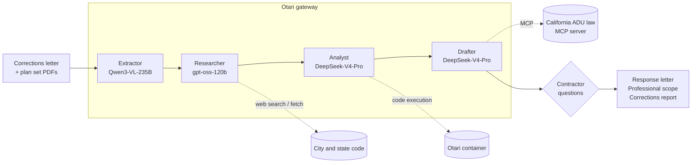

# Structura

**Autonomous civic and permit intelligence.** Open-weight multi-agent plan check for California ADU permits, routed,
guarded and metered through [Mozilla Otari](https://otari.ai).

[Live site](https://structura-otari.vercel.app) ·
[First Otari commit](https://github.com/bhavya-jpg/structura-otari/commit/c71d6ad34de90b192e58913b471c384101e0af90) ·
[Friction log](OTARI_FRICTION_LOG.md) ·
[Submission notes](docs/submission/SUBMISSION_FORM.md)

Built for Mozilla's *Developers Wilding* hackathon (November 2026).

---

## The problem

When a California city reviews plans for an accessory dwelling unit (ADU), it often sends back a corrections letter
with a dozen or more items. Each item cites a different source: state ADU law, the California Residential Code, the
plumbing code, or the city's own municipal code. For every item the contractor has to work out what it means, which
sheet must change, and whether they can fix it themselves or need the designer or engineer. That takes days to weeks
per round, and every round delays new housing.

## What Structura does

Give Structura the city's corrections letter and the full plan set. It:

1. **Reads** the scanned letter and every plan sheet as images, so a letter with no text layer still works.
2. **Researches** the state law and city ordinance each item cites.
3. **Checks the numbers** (setbacks, lot coverage, fee thresholds) by running code, not by guessing.
4. **Sorts** every item into *fix it now*, *ask the contractor* or *needs a professional*.
5. **Asks** the contractor only what it can't find in the plans (pipe sizes, distances, framing details).
6. **Drafts** the response package: a response letter, a professional scope of work and a corrections report.

A city plan checker can use the same pipeline the other way round, to pre-screen a submission before it reaches review.

### Real results

On a real second-round corrections letter from the City of Placentia (1232 N Jefferson St, a 600 sq ft detached ADU):

| Run | What happened | Gateway calls | Cost | Time |
|---|---|---|---|---|
| Analysis (6 Nov 2026) | 14 correction items read and categorized | 14 | $0.21 | 12 min 27 s |
| Response | Final package drafted from the contractor's answers | 4 turns | $0.09 | 1 min 37 s |

Costs are what Otari reported in `usage.cost_usd`.

---

## How it works

Four agents run in sequence. Each one uses its own open-weight model, with a backup model in case the primary is
refused or fails, and every model call goes through the Otari gateway.



| Agent | Primary model | Backup | Job | Otari features |
|---|---|---|---|---|
| Extractor | `alibaba/qwen3-vl-235b-a22b-instruct` | `deepseek/deepseek-v4.1-flash` | Reads the letter and plan sheets as images | Vision routing, prompt-injection guardrail, streaming |
| Researcher | `openai/gpt-oss-120b` | `openai/gpt-oss-20b` | Finds the ordinance and code each item cites | Web search and fetch, narrowed when a workspace disables them |
| Analyst | `deepseek/deepseek-v4-pro-0813` | `deepseek/deepseek-v4.1-flash` | Computes setbacks, coverage and fees, then re-checks them | Code execution, one container reused across turns |
| Drafter | `deepseek/deepseek-v4-pro-0813` | `moonshotai/kimi-k2.6` | Categorizes items and writes the response package | MCP server of California ADU law, local tool loop as fallback |

Every role can be overridden with `OTARI_MODEL_<ROLE>` and `OTARI_MODEL_<ROLE>_FALLBACK`.

### The Otari Inspector

Permit work needs an audit trail, so the workspace has a side panel called the Inspector. It shows, for every call:

- the model and provider that served it, and how many attempts it took (`Otari-Attempt-Count`)
- the guardrail verdict
- the code container the analyst used, and whether it was reused
- the cost, against the contractor's key and budget
- the status of the MCP and guardrail webhooks

Its **Trace Explorer** tab lists every call in the conversation, with model, latency and cost.

Three toggles call the real gateway, so judges can trigger each behaviour on demand:

| Toggle | What it shows |
|---|---|
| Force Primary Provider Failover | The primary model is unroutable, so a backup model serves the request on attempt 2 |
| Simulate Prompt Injection PDF | A poisoned document is sent with a block-mode guardrail, and the Inspector reports the verdict |
| Switch to Exhausted Contractor Key | A key with no budget left gets a real `403 budget_exceeded`, and the run stops with a hold |

---

## Otari features used

Status is what has been seen on real gateway responses, not just what the code supports.

| Feature | Status |
|---|---|
| Open-weight models only | ✅ Proven live: Qwen3-VL, gpt-oss-120b and DeepSeek-V4-Pro all served real runs |
| Multiple models in distinct roles | ✅ Proven live: vision extraction, research, analysis and drafting |
| Routing and fallback | ✅ Proven live: a real refusal moved to the backup model, which answered; the failover toggle repeats it |
| Code execution | ✅ Proven live: one container served both analyst turns (`container: "auto"`, then `otari-container-id`) |
| Streaming and cost tracking | ✅ Every request is streamed; cost comes from the final usage chunk or `response.completed` |
| Web search and fetch | ⚙️ Built in; the test workspace has them disabled, so the researcher fell back to verified local references |
| MCP | ⚙️ Built in (`/api/mcp/adu-law`); the gateway calls it only through a public tunnel, otherwise a local tool loop runs |
| Guardrails | ⚙️ Built in, plus a guardrail service in Otari's documented format; otari.ai has no hosted guardrail service yet |
| Budgets and per-contractor keys | ⚙️ Built in; a real `402 insufficient_funds` was handled as a hold, and per-contractor keys need keys created in the dashboard |

The honest gaps, and how each was found, are in [OTARI_FRICTION_LOG.md](OTARI_FRICTION_LOG.md).

---

## Run it locally

You need Node 20+, an [Otari](https://otari.ai) API key, and poppler and ImageMagick for rendering plan sheets:

```bash
brew install poppler imagemagick
git clone https://github.com/bhavya-jpg/structura-otari.git
cd structura-otari
(cd server && npm install && cp .env.example .env)
(cd frontend && npm install)
```

Edit `server/.env`:

```bash
OTARI_API_KEY=<your Otari key>
SUPABASE_URL=http://127.0.0.1:54321           # local stand-in, started by run-local.sh
SUPABASE_SERVICE_ROLE_KEY=local-service-role
OTARI_DEMO_CONTROLS=true
OTARI_INSPECTOR_TOKEN=<openssl rand -hex 32>
```

Create `frontend/.env.local`:

```bash
NEXT_PUBLIC_SUPABASE_URL=http://127.0.0.1:54321
NEXT_PUBLIC_SUPABASE_ANON_KEY=local-anon
NEXT_PUBLIC_CROSSBEAM_LOCAL_MODE=true
SUPABASE_SERVICE_ROLE_KEY=local-service-role
CLOUD_RUN_URL=http://localhost:8080
OTARI_INSPECTOR_TOKEN=<the same value as the server>
```

Then start everything:

```bash
./scripts/run-local.sh          # add --prod for a production build of the frontend
```

This starts three processes and stops them together:

| Process | Port | What it is |
|---|---|---|
| Local data store | 54321 | A Supabase-compatible stand-in (`server/src/local/supabase-compat.ts`), so no Supabase project is needed |
| Server | 8080 | Express API with the agent pipeline, plus a loopback tools listener on 8090 for MCP and guardrails |
| Frontend | 3000 (or the next free port) | The Next.js app |

Open the frontend and click **Open Live Permit Review Workspace**. Local mode signs you in as
`judge@structura.local` / `structura-local`. The seeded projects use the real PDFs in `test-assets/corrections/`.
To start over, delete `server/.local-data`.

### Using the app

1. **Home page:** the run schedule shows every call from the first live run. Pick an agent to see its model and calls,
   or press **Replay at 60×**.
2. **Dashboard:** choose a perspective. **City Reviewer** pre-screens a submission (**Run AI Review**).
   **Contractor** works through a corrections letter (**Analyze Corrections**).
3. **Questions:** when the analysis finishes, answer the contractor questions and click **Submit & Generate Response**.
4. **Results:** read the **Response Letter**, **Professional Scope** and **Corrections Report** tabs.
5. **Inspector:** click **Otari** on the right edge. Try the three toggles, then open **Trace Explorer**.
6. **Run again:** **Reset & Run Again** at the bottom of the results.

### Gateway MCP and guardrails (optional)

The gateway can only call the MCP server and guardrail service if they are reachable from the internet. In a second
terminal:

```bash
brew install cloudflared
./scripts/tunnel.sh
```

Add the `OTARI_PUBLIC_TOOLS_URL` it prints to `server/.env` and restart the server. The tunnel exposes only the MCP
and guardrail routes on port 8090, never `/generate`, which spends credit and has no auth.

### Useful settings

All settings are documented in [`server/.env.example`](server/.env.example). The ones you're most likely to change:

| Variable | Effect |
|---|---|
| `OTARI_CONTRACTOR_KEY` | Runs spend on this contractor's own virtual key instead of the workspace key |
| `OTARI_CONTRACTOR_BUDGET_USD` | Display cap for the Inspector's budget bar (the gateway's ceiling is what refuses) |
| `OTARI_EXHAUSTED_CONTRACTOR_KEY` | A key with no budget left, so the exhausted-key toggle gets a genuine refusal |
| `OTARI_HYBRID_FALLBACK` | Calls the gateway, and shows recorded output if it returns 402 (the UI says so) |
| `OTARI_MODEL_<ROLE>` | Overrides a role's model (`EXTRACTOR`, `RESEARCHER`, `ANALYST`, `DRAFTER`) |

### Tests

```bash
cd server && npm test
```

The suite (79 tests at the last run) covers the gateway client and stream parsing, the runner's failover and tool
narrowing, the Inspector routes, the guardrail service and the public tools listener. It makes no network calls.

---

## Deployment

The [live site](https://structura-otari.vercel.app) is the frontend on Vercel in **public-site mode**
(`NEXT_PUBLIC_STRUCTURA_PUBLIC_SITE=true`). In that mode only the landing page is served, with the full run schedule
and replay, and the workspace buttons link to these run-it-locally instructions.

The agent server isn't hosted on purpose: it holds the Otari key, and `/generate` spends credit. `frontend/.vercelignore`
keeps every `.env` file out of uploads.

To host the full app, deploy `server/` anywhere that runs Node (it ships a `Dockerfile`), point it at a real Supabase
project, set `OTARI_INSPECTOR_TOKEN` on both sides, and set `CLOUD_RUN_URL` on the frontend.

---

## Repository layout

| Path | What's there |
|---|---|
| `server/src/otari/` | Gateway client, streaming parser, the 4-stage runner, guardrail service, MCP server, Inspector demos, replay |
| `server/src/routes/` | `/generate`, `/extract` and the Inspector's `/api/otari/*` routes |
| `server/src/local/` | The local Supabase stand-in |
| `server/skills/` | California ADU law and city references the agents read (Placentia, Buena Park) |
| `server/test/` | Server test suite |
| `frontend/` | Next.js 16 app: landing page, dashboard, workspace, Otari Inspector |
| `scripts/` | `run-local.sh`, `tunnel.sh`, demo seeding |
| `test-assets/` | Real permit documents used for development and the demo |
| `docs/submission/` | Hackathon form answers, Otari feedback, logo and thumbnail |
| `OTARI_FRICTION_LOG.md` | What we found integrating Otari, with reproduction steps |
| `SUBMISSION_PACKET.md` | Rubric mapping, demo shot list and setup notes |

The `agents-crossbeam/`, `adu-skill-development/`, `design-directions/` folders and most of `docs/` are from the
original CrossBeam project and are kept for history.

## Tech stack

- **Inference:** Mozilla Otari (`/chat/completions` and `/responses`, streaming, code execution, guardrails, MCP tools,
  virtual keys and budgets, traces)
- **Models:** Qwen3-VL-235B, gpt-oss-120b and DeepSeek-V4-Pro, with gpt-oss-20b, DeepSeek-V4.1-Flash and Kimi K2.6 as backups
- **Server:** Node.js, Express 5, TypeScript, Zod
- **Frontend:** Next.js 16, React, Tailwind CSS v4, shadcn/ui
- **Data:** Supabase, or the bundled local stand-in
- **Documents:** poppler and ImageMagick

---

## Test data attribution

The `test-assets/` directory contains real permit documents used for development and testing:

- **California ADU Handbook** (`adu-handbook-update-2026.pdf`): published by the California Department of Housing and Community Development (HCD). Public government document.
- **Placentia Submittal Requirements**: published by the City of Placentia Building Division. Public government document.
- **Corrections Letter** (`corrections/2nd-Review-Corrections-1232-Jefferson-St-Placentia.pdf`): City of Placentia plan check corrections. Public government correspondence.
- **Architectural Plans, 1232 N Jefferson, Placentia** (`corrections/Binder-1232-N-Jefferson.pdf`): included with permission from the project designer for demonstration purposes.
- **Architectural Plans, 326 Flint Ave, Long Beach** (`approved/FLINT-AVE-326-BADD326126-APPROVED-PLANS.pdf`): included with permission from the project designer for demonstration purposes.

## Origins and license

Structura began as a fork of the open-source CrossBeam hackathon project (MIT). It replaces CrossBeam's Anthropic Agent
SDK and Vercel Sandbox runtime with the Otari gateway and open-weight models, and adds the Inspector, failover,
guardrails, MCP, budgets and the local data store. It is not affiliated with CrossBeam Permits.

MIT, see [LICENSE](LICENSE). The upstream copyright notice is kept in the license file.
